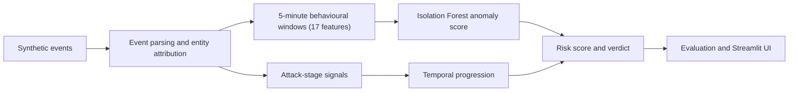

# Find the Intruder: progression-aware ML intrusion detection

ALGOTHON'26 · Problem statement **ALG-CYBER-01, "Find the Intruder"**

> **Research question.** Does adding temporal attack progression to behavioural anomaly detection improve intrusion detection and reduce false positives from benign look-alike activity?

Anomaly detectors flag anything unusual, so mistyped passwords, backups and noisy clients flood analysts with false alarms. Real intrusions don't just look unusual: they **progress** through stages. Find the Intruder asks three questions for every entity (network address) and day:

1. **Is the behaviour unusual?** An Isolation Forest trained only on benign activity scores 17 behavioural features per five-minute window.
2. **Is there evidence of attack activity?** Rules detect signals for six stages: reconnaissance, credential attack, compromise, privilege escalation, persistence and exfiltration.
3. **Do the signals form a plausible progression?** An order-sensitive progression score checks whether the stages happen in attack order over time.

The answers are combined into a **risk score (0–100)** and one of four verdicts: **Normal, Suspicious, Failed attack or Intrusion**. Every verdict is explained in the investigation interface.

## Pipeline



Ground truth is used only by the evaluation step, never by the detector.

## The app

| Page | What it shows |
|---|---|
| Dashboard | Detection overview, attack activity by stage, high-risk entities |
| Intruders | Every flagged entity ranked by risk, with verdict, stages seen and detection latency |
| Attack Stories | The stage-by-stage progression and a timeline with real timestamps; failed attacks show where the attack stopped |
| Evidence | Why it was flagged: behavioural profile against the benign baseline, the events behind each stage, raw events |
| Evaluation | The three detectors compared on the same data, in-distribution and shifted (OOD) |
| About, User Guide, Quick Tour | How the model works, plain-English Q&A, a 60-second walkthrough |

Light and dark themes are available from the sidebar.

## Results

Three detectors are compared on exactly the same entity-days (the evaluation unit is entity × day):

- **A, Behaviour Anomaly:** anomaly score only
- **B, Attack Signals:** anomaly score plus the number of distinct attack stages (order ignored)
- **C, Attack Progression (proposed):** anomaly score plus temporal progression

| Detector | Test set | Precision | Recall | F1 | False positive rate | Look-alike false positives |
|---|---|---|---|---|---|---|
| A, Behaviour Anomaly | ID | 0.009 | 87.5% | 0.017 | 27.1% | 32 of 32 |
| B, Attack Signals | ID | 0.038 | 70.8% | 0.072 | 4.9% | 26 of 32 |
| C, Attack Progression | ID | 0.038 | 70.8% | 0.072 | 4.9% | 26 of 32 |
| A, Behaviour Anomaly | OOD | 0.007 | 100% | 0.015 | 62.3% | 32 of 32 |
| B, Attack Signals | OOD | 0.027 | 83.3% | 0.052 | 13.8% | 28 of 32 |
| C, Attack Progression | OOD | 0.027 | 83.3% | 0.053 | 13.7% | 28 of 32 |

ID = test data with the same benign behaviour profile as training. OOD = test data with deliberately shifted benign behaviour.

**What this shows (honestly):**

- Adding attack evidence cuts the false positive rate from 27.1% to 4.9% (ID) and from 62.3% to 13.7% (OOD), at the cost of lower recall.
- Precision is still low, and thresholds are provisional (not yet calibrated on validation data).
- B and C flag almost the same entity-days. In the current configuration, temporal ordering mainly changes the verdict (Intrusion versus Failed attack) rather than which entities are flagged. So the answer to the research question is **"partly"**.

Full results: [`results/results_table.md`](results/results_table.md) and [`results/metrics.json`](results/metrics.json).

## Run it

Requires Python 3.11+ (developed on 3.13).

```bash
pip install -r requirements.txt
streamlit run app.py
```

The detection results are already in `results/`, so the app runs straight away. To regenerate everything:

```bash
python -m generator.generate --out data/generated --seed 42
python train.py --data data/generated --out models --seed 42
python predict.py --data data/generated --model models/isolation_forest.pkl --splits val test_id test_ood --out results
python -m evaluation.run --predictions results/predictions.csv --data data/generated --splits val test_id test_ood --out results
python -m pytest -q
```

233 automated tests cover parsing, features, the model, stage signals, progression, prediction, evaluation and the app pages.

## Data

All data is **synthetic** and generated by `generator/`: abstract, non-operational security events (no exploit payloads or attack commands), a host inventory and a separate ground-truth file. Addresses use private and documentation IP ranges only. Splits:

- `train`: benign activity only
- `val`: validation
- `test_id`: same benign behaviour profile as training
- `test_ood`: shifted benign behaviour

Benign look-alike "traps" are included: typo logins, internal backups, failed external authentication and noisy clients.

## Limitations

- Results come from synthetic data and may not carry over to real networks.
- Thresholds are provisional, and precision is low.
- The evaluation unit is entity × day, so attacks are assumed not to cross midnight.
- This is an offline research prototype: no real-time monitoring and no automated response.

## Tech stack

Python, pandas, NumPy, scikit-learn, Streamlit, Plotly, pytest. No database and no external APIs.

## AI / tool disclosure

Claude (Anthropic) via Claude Code assisted with the event loader, feature extraction, interface contracts, evaluation harness, generator updates, training and prediction wiring, tests, the Streamlit interface and this README. The detection core (anomaly model, attack-stage rules, temporal progression and prediction logic) was written by the author, with small AI-assisted fixes. All code was reviewed by the author. No external datasets were used.
